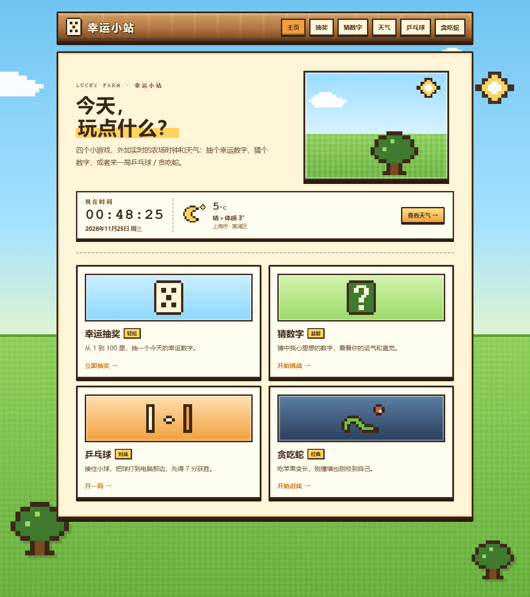
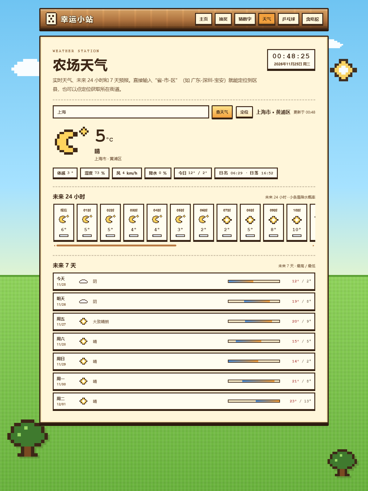

# 幸运小站 Lucky Farm

一个用 **Flask + 原生 HTML/CSS/JavaScript** 写的像素风小游戏合集。前端不依赖任何框架、CDN 或图片素材，像素图标全部由 Python 生成 SVG。



## 功能

| 页面 | 说明 |
| --- | --- |
| `/` | 主页：实时时钟、当前天气、四个游戏入口 |
| `/dice` | 幸运抽奖：1–100 随机数，记录抽奖次数和最近结果 |
| `/guess` | 猜数字：提示大小、自动缩小范围、猜中庆祝 |
| `/weather` | 天气：实时天气、未来 24 小时、未来 7 天、城市/区县搜索、定位 |
| `/pong` | 乒乓球：鼠标或 ↑↓ 控制，先得 7 分获胜 |
| `/snake` | 贪吃蛇：方向键 / WASD，吃苹果加分，最高分保存在浏览器 |



## 项目结构

```
lucky-farm/
├── app.py                  # Flask 入口和页面路由
├── area_search.py          # 中文省/市/区搜索
├── sprites.py              # 像素图标（字符画 -> SVG）
├── data/
│   └── areas.json.gz       # 全国省市区坐标表（3237 条，压缩后约 54KB）
├── static/
│   ├── css/style.css       # 全站像素风样式
│   └── js/
│       ├── weather-core.js # 时钟、天气 API、地址解析
│       ├── home.js         # 主页天气卡片
│       ├── weather.js      # 天气页交互
│       ├── pong.js         # 乒乓球
│       └── snake.js        # 贪吃蛇
├── templates/              # Jinja2 页面模板
│   ├── base.html
│   ├── home.html
│   ├── dice.html
│   ├── guess.html
│   ├── weather.html
│   ├── pong.html
│   ├── snake.html
│   └── 404.html
├── docs/                   # README 截图
├── requirements.txt
└── README.md
```

## 运行

需要 Python 3.9 及以上。

```bash
# 1. 创建虚拟环境（可选）
python -m venv .venv

# Windows
.venv\Scripts\activate
# macOS / Linux
source .venv/bin/activate

# 2. 安装依赖
pip install -r requirements.txt

# 3. 启动
python app.py
```

打开 <http://127.0.0.1:5000>。

## 天气和地址

- 实时天气、24 小时、7 天预报来自 [Open-Meteo](https://open-meteo.com/)，免费且不需要 API Key。
- 定位后的街道级地址由 [BigDataCloud](https://www.bigdatacloud.com/) 反向地理编码提供。
- 国内省、市、区搜索使用仓库内的本地坐标表，因此搜“广东-深圳-宝安”“重庆市渝北区”不会跑到同名地点。
- 区划坐标数据来源：[GeoMapData_CN](https://github.com/lyhmyd1211/GeoMapData_CN)（阿里云 DataV 行政区划数据）。

> 浏览器定位只允许在 **HTTPS** 或 **localhost** 下使用。通过局域网 IP（如 `http://192.168.1.10:5000`）访问时，定位会失败并自动退回网络 IP 定位，准确度只能到城市级；需要街道级请在电脑本机打开，或给网站配置 HTTPS。

## 说明

- `app.secret_key` 只是本地演示用，正式部署请改成随机字符串并从环境变量读取。
- 猜数字、抽奖次数等保存在 Flask 的签名 session 中；贪吃蛇最高分保存在浏览器 localStorage。
- 像素图标、CSS 和 Canvas 游戏全部手写，没有引入前端构建工具。

## License

代码使用 MIT License。第三方天气数据、地理编码数据和行政区划数据的版权归各自提供方所有。
